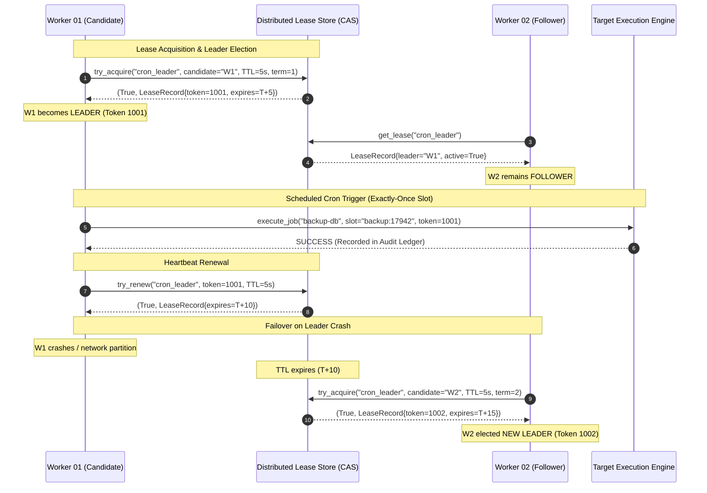

# ⏰ Distributed Cron Leader

[](https://github.com/txltedxgod/distributed-cron-leader/actions/workflows/ci.yml)
[](https://opensource.org/licenses/MIT)
[](https://www.python.org/)
[](https://fastapi.tiangolo.com/)
[](#architecture)
[](https://www.docker.com/)

Production-grade distributed cron scheduler with atomic lease-based leader election, split-brain fencing tokens, and exactly-once job execution guarantees in Python & Docker.

---

## 🏛️ Architecture & Leader Election Protocol



---

## ✨ Key Features

- **Atomic Leader Election**: Distributed compare-and-swap (CAS) lease lock with configurable TTL and proactive heartbeat renewals.
- **Split-Brain & Zombie Defense**: Monotonically increasing fencing tokens (epoch tokens) guarantee that partitioned or delayed nodes cannot perform duplicate execution.
- **Exactly-Once Execution Slots**: Time-window slot deduplication (`job:window_epoch`) ensures cron tasks fire exactly once across the cluster, even during failover transitions.
- **Flexible Schedule Expressions**:
  - Standard 5-field cron syntax (`*/5 * * * *`, `0 0 * * *`).
  - Human-friendly interval macros (`@hourly`, `@daily`, `@weekly`, `@minutely`).
  - Relative duration intervals (`@every 15s`, `@every 5m`, `@every 2h`).
- **Audit History & Execution Telemetry**: Tracks start time, execution duration (ms), assigned leader, fencing token, retry attempts, and detailed error traces.
- **REST API & Cloud-Native**: Production FastAPI interface with `/healthz`, `/api/v1/cluster/status`, job management CRUD, and manual ad-hoc triggers.

---

## 🚀 Quickstart

### Local Setup

```bash
git clone https://github.com/txltedxgod/distributed-cron-leader.git
cd distributed-cron-leader

python -m venv .venv
source .venv/bin/activate  # On Windows: .venv\Scripts\activate
pip install -r requirements.txt
```

### Run Tests

```bash
pytest -v tests/
```

### Run Server

```bash
uvicorn cron.api:app --host 0.0.0.0 --port 8000 --reload
```

---

## 📡 REST API Reference

### 1. Cluster Status
`GET /api/v1/cluster/status`

**Response (200 OK):**
```json
{
  "node_id": "worker-01",
  "role": "LEADER",
  "term": 1,
  "fencing_token": 1001,
  "active_leader_id": "worker-01",
  "lease_ttl_seconds": 5.0,
  "active_jobs_count": 3
}
```

### 2. Schedule a New Cron Job
`POST /api/v1/jobs`

**Request Payload:**
```json
{
  "name": "nightly-database-backup",
  "cron_expr": "@daily",
  "timeout_sec": 60.0,
  "retry_limit": 3
}
```

**Response (201 Created):**
```json
{
  "status": "scheduled",
  "job": "nightly-database-backup",
  "assigned_leader": "worker-01"
}
```

### 3. Trigger Job Execution (Ad-Hoc)
`POST /api/v1/jobs/{name}/trigger`

Triggers immediate job execution verified against the current cluster leader lease and slot lock.

---

## 🛡️ License

MIT License. See [LICENSE](LICENSE) for details.
